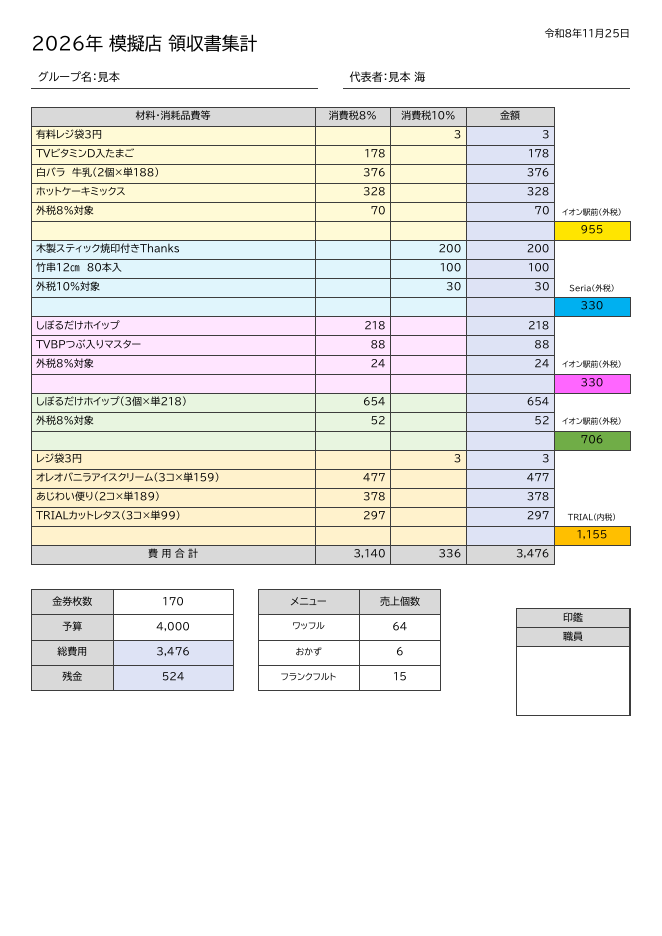

# mogiten-ledger

模擬店の準備で**購入した**物品のレシートを店ごとに記録し、領収書集計の表をPDFで出力するWebアプリです。
スマホのブラウザ向けですが、PCでも使えます。データはその端末のブラウザ内にだけ保存されます（サーバーには送りません）。



## できること

- **ホーム**：記録したレシートを店ごとに色分けしたカードで一覧表示。右上から PDF 出力と集計へ。
- **レシートを記録**：店名と外税／内税 → 購入品（商品名・金額・税率 8%/10%）を折りたたみ欄で入力。
  - 外税の店は、税率ごとの小計から消費税を計算（1円未満切り捨て）。0円の税額行は出しません。
  - カードの「編集」から、入力の修正・購入品の追加・レシートの削除ができます。
- **集計**：金券枚数・予算・総費用・残金、メニューごとの売上個数（任意）。
- **PDF出力**：見本の「領収書集計」と同じ形の表（店ごとに色分け）、集計表、印鑑欄。

## 注意

- データはブラウザの保存領域（localStorage）にあります。ブラウザの履歴・サイトデータを消すと消えます。別の端末とは共有されません。
- プライベートブラウズでは保存できないことがあります（画面に警告が出ます）。

## 開発

```bash
npm install
npm run dev      # 開発サーバー
npm test         # テスト
npm run build    # dist/ に静的ファイルを出力
```

静的ファイルだけで動くので、`dist/` を GitHub Pages などに置けば公開できます。

## ライセンス表記

PDFに埋め込むフォント [BIZ UDPGothic](https://github.com/googlefonts/morisawa-biz-ud-gothic) は SIL Open Font License 1.1 です（`public/fonts/OFL.txt`）。
